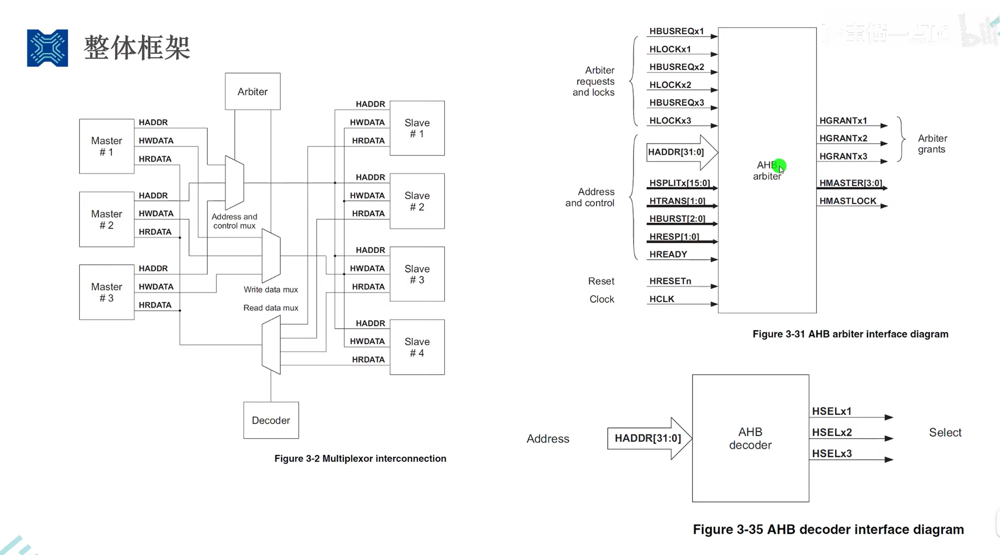

# AHB 总线接口与信号说明

这张图展示的是 **AMBA 2.0 的多主设备 AHB 片内总线**，包含仲裁、锁定和 SPLIT 功能。图中的线连接芯片内部模块。这里按图中的经典完整 AHB 说明，不应把其中的全部信号直接套用到 AHB-Lite 或某一芯片的具体实现。

## 1. 图中各模块的职责

| 模块 | 中文名称 | 职责与例子 |
|---|---|---|
| Master | 主设备 | 主动发起读写访问，例如 CPU、DMA。 |
| Slave | 从设备 | 响应主设备的访问，例如 SRAM 控制器、AHB 到 APB 的桥。 |
| Arbiter | 仲裁器 | 在多个主设备之间分配总线使用权。 |
| Decoder | 地址译码器 | 根据访问地址，判断目标从设备并产生选择信号。 |
| MUX / Multiplexer | 多路选择器 | 从多路输入中选择一路接到输出。图中分别选择地址/控制、写数据、读数据。 |

主设备和从设备按“谁发起访问”区分，不能按数据流向区分：读操作的数据由从设备返回，但访问仍由主设备发起。

## 2. 信号命名与位宽

- `H` 前缀表示 AHB 信号。
- `[31:0]` 表示 32 位；`[3:0]` 表示 4 位；`[15:0]` 表示 16 位。
- `x1 / x2 / x3` 表示不同设备各自的一条信号，不是一个信号的三个位。
- `HRESETn` 中的 `n` 表示低电平有效。
- 同名信号在左右两张图中重复出现，下面合并说明。多位总线在框图中也可能画成一条线。

## 3. 图中所有已命名信号

| 信号 | 谁发出 | 谁接收 | 用途 |
|---|---|---|---|
| **HADDR[31:0]** | 发起访问的主设备 | 经地址/控制选择器送到各从设备、译码器、仲裁器 | **访问地址**，表示要读写哪个位置。译码器根据地址选中对应从设备；从设备再据地址定位内部资源。 |
| **HWDATA** | 当前数据阶段对应的主设备 | 经写数据选择器送到从设备 | **要写入的数据**。线路可以连接多个从设备，但只有本次有效写访问对应的从设备接收写入。 |
| **HRDATA** | 当前数据阶段对应的从设备 | 经读数据选择器返回主设备 | **读出的数据**。选择器从多个从设备的输出中选出本次需要的一路；对应主设备在读传输成功完成时接收。 |
| **HBUSREQx1 / x2 / x3** | 对应的主设备 1 / 2 / 3 | 仲裁器 | **申请使用总线**。每个主设备有自己的请求线，可以同时提出申请，由仲裁器决定授权对象。 |
| **HLOCKx1 / x2 / x3** | 对应的主设备 | 仲裁器 | **申请锁定访问**。表示需要进行一组不可被其他主设备插入的传输；锁定序列开始后，仲裁器必须维持所需的总线使用权。 |
| **HGRANTx1 / x2 / x3** | 仲裁器 | 对应的主设备 | **总线授权**。表明仲裁器选中了该主设备；真正接管地址/控制总线还需要满足 `HREADY` 和时钟边沿条件。 |
| **HMASTER[3:0]** | 仲裁器 | 地址/控制选择器，以及支持 SPLIT 的从设备 | **当前地址阶段的主设备编号**。选择器据此选中主设备；支持 SPLIT 的从设备据此记录访问来自哪个主设备。 |
| **HMASTLOCK** | 仲裁器 | 从设备，特别是支持 SPLIT 的从设备 | **当前传输属于锁定序列**。它与当前地址/控制阶段对应，向从设备表明当前传输的锁定属性。 |
| **HSPLITx[15:0]** | 支持 SPLIT 的从设备 x | 仲裁器 | **允许此前被 SPLIT 的主设备重新参加仲裁**。每一位对应一个主设备编号；某位置 1，表示该主设备可以重新获得仲裁机会并重试。 |
| **HTRANS[1:0]** | 当前地址阶段的主设备 | 从设备、仲裁器 | **传输类型**：`00 IDLE` 空闲；`01 BUSY` 突发中暂时不能提供下一拍；`10 NONSEQ` 单次传输或突发首拍；`11 SEQ` 突发后续拍。 |
| **HBURST[2:0]** | 当前地址阶段的主设备 | 从设备、仲裁器 | **突发类型**：单次、未指定长度的递增突发，以及 4/8/16 拍的递增或回绕突发。仲裁器也可参考它进行总线分配。 |
| **HRESP[1:0]** | 当前数据阶段对应的从设备 | 经响应选择逻辑送到主设备、仲裁器 | **响应结果**：`00 OKAY` 正常；`01 ERROR` 错误；`10 RETRY` 要求重试；`11 SPLIT` 暂时退出并等待重新获准后重试。 |
| **HREADY** | 当前数据阶段对应的从设备 | 经响应选择逻辑送到主设备、仲裁器及各从设备 | **当前数据阶段能否结束**。`0`：插入等待、延长传输；`1`：本阶段可以结束、流水线可以推进。访问是否成功还要结合 `HRESP` 判断。 |
| **HSELx1 / x2 / x3** | 地址译码器 | 对应的从设备 1 / 2 / 3 | **从设备选择**。例如地址落在从设备 2 的范围，译码器便选中从设备 2。此信号与地址阶段对应。 |
| **HRESETn** | 系统复位控制器 | 主设备、从设备、仲裁器等需要复位的模块 | **复位信号，低电平有效**。用于使相关模块进入规定的初始状态。 |
| **HCLK** | 系统时钟产生/分配电路 | 主设备、从设备、仲裁器等时序模块 | **AHB 总线时钟**，传输时序以其上升沿为基准。纯组合译码逻辑本身不需要时钟。 |

补充说明：

- 图中没有标出 `HWDATA`、`HRDATA` 的位宽，常见实现为 32 位，也可以更宽；总线位宽不等于每次访问的数据宽度。
- `HSPLITx` 中的 `x` 标识发出通知的从设备，而 `[15:0]` 中的每一位对应一个主设备编号。
- 右上角只画出仲裁器所需的连接；一个信号还可能连接其他模块，例如 `HADDR` 同时供从设备和译码器使用。
- 左图没有完整画出响应选择逻辑。多个从设备各有自己的响应输出，公共 `HREADY`、`HRESP` 必须选择当前数据阶段对应从设备的响应。

## 4. 左图中没有标名字的三条控制线

| 图中连线 | 谁发出 → 谁接收 | 用途 |
|---|---|---|
| Arbiter → Address and control mux | 仲裁器 → 地址/控制选择器 | 选择哪个主设备的地址和控制信号接到公共总线上，通常由 `HMASTER` 控制。 |
| Arbiter → Write data mux | 仲裁相关控制逻辑 → 写数据选择器 | 选择哪个主设备的写数据接出去。选择信息必须对应**当前数据阶段的主设备**。 |
| Decoder → Read data mux | 译码及选择保持逻辑 → 读数据选择器 | 选择返回哪个从设备的读数据。选择信息必须对应**当前数据阶段的从设备**。 |

这三条线是框图中的选择控制连接；实际实现可能包含编码、寄存器及保持逻辑，不一定各自只是一根物理信号线。

## 5. 必须分清的仲裁与时序规则

### 5.1 请求、授权与实际接管是三个环节

1. 主设备通过 `HBUSREQx` 申请总线。
2. 仲裁器按照仲裁策略选中主设备，并给出对应的 `HGRANTx`。
3. 主设备在 **`HGRANTx = 1` 且 `HREADY = 1` 的 `HCLK` 上升沿**取得地址/控制总线使用权。

因此，不能只看 `HGRANTx = 1` 就立即切换总线。当前传输还在等待时，需要遵守总线交接时序。

### 5.2 地址阶段与数据阶段可以属于不同的访问

AHB 采用流水线：前一次访问进入数据阶段时，后一次访问可以进入地址阶段。例如：

| 时钟周期示意 | 地址阶段 | 数据阶段 |
|---|---|---|
| 第 1 拍 | 访问 A 的地址/控制 | 之前访问的数据，或空闲 |
| 第 2 拍 | 访问 B 的地址/控制 | 访问 A 的数据 |
| 第 3 拍 | 访问 C 的地址/控制 | 访问 B 的数据 |

上表以没有等待状态为前提；A、B、C 表示不同访问，不表示它们一定由不同主设备发起。

因此：

- 地址/控制选择器跟随当前地址阶段的主设备。
- 写数据选择器跟随当前数据阶段的主设备；发生主设备交接时，这个主设备可能与当前地址阶段不同。
- 读数据及响应选择器跟随当前数据阶段的从设备，不能直接使用下一次访问的地址译码结果。
- 实现中需要保存相应的阶段归属信息。遇到 `HREADY = 0` 时还需要正确保持，不能简单地无条件每拍更新选择信息。

### 5.3 HSEL 表示地址选中，不能单独当作读写执行条件

多个从设备可以同时看到公共地址和写数据，但只有被选中的从设备负责响应本次访问。判断是否接受一次新的有效访问时，还需要结合：

- `HREADY`：允许地址/控制阶段被接受、流水线推进。
- `HTRANS`：`NONSEQ` 或 `SEQ` 才表示有效访问；`IDLE`、`BUSY` 不执行普通数据读写。
- `HWRITE`：决定读还是写。

从设备需要保存已接受访问的信息，在对应的数据阶段完成操作。

### 5.4 HREADY 与 HRESP 必须结合看

- `HREADY = 0`：当前数据阶段需要延长。
- `HREADY = 1`：当前数据阶段可以结束。
- `HRESP`：说明本次响应是正常、错误、重试还是 SPLIT。

所以，`HREADY = 1` 本身不等于“本次读写成功”。具体的非 OKAY 响应还必须遵循其规定的多周期响应时序。

### 5.5 HLOCKx 与 HMASTLOCK 的对象不同

- `HLOCKx`：**主设备 → 仲裁器**，提出锁定需求。
- `HMASTLOCK`：**仲裁器 → 从设备**，标明当前传输处于锁定序列。

它们描述的是硬件总线传输的锁定，不能直接等同于操作系统的调度锁或关中断。

### 5.6 SPLIT 通知恢复的是仲裁资格

从设备通过 `HRESP = SPLIT` 让暂时无法完成的访问退出总线，仲裁器暂时屏蔽该主设备的仲裁资格，以便其他主设备使用总线。待该从设备准备好后，通过 `HSPLITx` 的对应位通知仲裁器恢复该主设备的资格。

**HSPLIT 不是读数据，也不意味着原访问已自动完成。** 主设备仍需要重新获得总线并重试访问。

## 6. 图中省略的常用控制信号

左图是简化框图，地址/控制路径还通常包括以下信号：

| 信号 | 谁发出 → 谁接收 | 用途 |
|---|---|---|
| `HWRITE` | 主设备 → 从设备 | 读写方向：`0` 表示读，`1` 表示写。 |
| `HSIZE[2:0]` | 主设备 → 从设备 | 每拍访问的数据宽度，例如字节、半字、字。 |
| `HPROT[3:0]` | 主设备 → 需要这些属性的从设备或保护逻辑 | 访问属性，例如指令/数据、用户/特权、可缓存/可缓冲。 |

## 7. 参考资料

- [ARM AMBA Specification Rev 2.0，ARM IHI 0011A](https://documentation-service.arm.com/static/5f916403f86e16515cdc3d71)
- §2.2：AHB 信号列表。
- §3.2、图 3-2：多路选择器互连结构。
- §3.4、§3.8、§3.9：基本传输、地址译码、从设备响应。
- §3.11、§3.12：仲裁及 SPLIT 传输。
- §3.20、图 3-31：仲裁器接口。
- §3.21、图 3-35：译码器接口。
